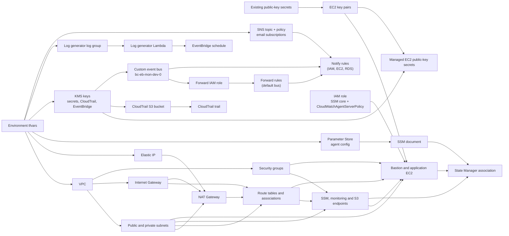

# EC2 + Systems Manager + CloudWatch Agent + CloudTrail

This implementation builds a VPC with a public and a private subnet, a bastion
EC2 instance and an application EC2 instance, both managed through AWS Systems
Manager. The CloudWatch agent is installed and configured on both instances
through State Manager to publish memory and disk metrics. A CloudTrail trail
writes to a KMS-encrypted S3 bucket, and a scheduled Lambda writes random
INFO, WARNING and ERROR log lines to CloudWatch Logs for testing. EventBridge
rules email an SNS topic, through a custom event bus, whenever an IAM user is
created, changed or removed and whenever EC2 or RDS instances are started,
stopped, terminated or modified.

## Runtime traffic flow

```mermaid
flowchart TB
  internet((Internet))
  operator["Operator<br/>Session Manager / SSH"]

  subgraph ingress["Ingress"]
    igw["Internet Gateway"]
  end

  subgraph public["Public subnet"]
    bastion["Bastion EC2<br/>Amazon Linux 2023"]
    nat["NAT Gateway<br/>+ Elastic IP"]
  end

  subgraph private["Private subnet"]
    direction LR
    app["Application EC2<br/>RHEL 9"]
    vpce["Interface endpoints<br/>ssm, ssmmessages,<br/>ec2messages, monitoring"]
    s3vpce["S3 gateway endpoint"]
  end

  subgraph management["Systems Manager"]
    direction LR
    ssm["Session Manager"]
    state["State Manager association<br/>install, configure, verify"]
    config["Parameter Store<br/>agent config"]
  end

  subgraph observability["Observability"]
    direction LR
    cwmetrics["CloudWatch metrics<br/>CWAgent: mem_*, disk_*"]
    gen_logs["Log group<br/>/aws/lambda/log-generator"]
    trail["CloudTrail"]
    bucket["S3 bucket<br/>(KMS encrypted)"]
  end

  subgraph generator["Log generator"]
    direction LR
    schedule["EventBridge schedule"]
    lambda["Lambda<br/>random log lines"]
  end

  subgraph alerting["Activity alerts"]
    direction LR
    api_calls["IAM, EC2 and RDS API calls<br/>(recorded by CloudTrail)"]
    default_bus["Default event bus<br/>forward rules"]
    mon_bus["Custom bus bc-eb-mon-dev-0<br/>(KMS encrypted)<br/>notify rules"]
    sns["SNS topic"]
    email["Email subscribers"]
  end

  sg{{"Security groups<br/>(bastion, application, endpoints)"}}

  internet --> igw
  igw --> bastion
  operator --> ssm
  ssm --> vpce
  vpce --> bastion
  vpce --> app
  bastion -.->|"SSH"| app
  app -->|"Outbound internet"| nat
  nat --> igw

  state --> config
  state -->|"targets by Name tag"| bastion
  state -->|"targets by Name tag"| app
  s3vpce -->|"agent package"| app
  bastion -->|"PutMetricData"| cwmetrics
  app -->|"PutMetricData"| vpce
  vpce --> cwmetrics

  schedule --> lambda
  lambda --> gen_logs

  trail --> bucket

  api_calls --> default_bus
  default_bus -->|"forward role"| mon_bus
  mon_bus -->|"formatted message"| sns
  sns --> email

  sg -.- bastion
  sg -.- app
  sg -.- vpce

  classDef ingress fill:#E8F7EE,stroke:#219653,stroke-width:1px;
  classDef publicTier fill:#DBEAFE,stroke:#2563EB,stroke-width:1px;
  classDef privateTier fill:#EDE9FE,stroke:#7C3AED,stroke-width:1px;
  classDef mgmt fill:#FFEDD5,stroke:#EA580C,stroke-width:1px;
  classDef obs fill:#FCE7F3,stroke:#DB2777,stroke-width:1px;
  classDef sgClass fill:#FEF3C7,stroke:#D97706,stroke-width:1px;
  class igw ingress
  class bastion,nat publicTier
  class app,vpce,s3vpce privateTier
  class ssm,state,config mgmt
  class cwmetrics,gen_logs,trail,bucket,schedule,lambda obs
  class api_calls,default_bus,mon_bus,sns,email mgmt
  class sg sgClass
```



The bastion has a public IP and an inbound SSH rule, while the application
instance has no public IP and accepts SSH only from the bastion security group.
The private route table sends `0.0.0.0/0` to the NAT gateway in the public
subnet, so the application instance has outbound internet access. AWS service
traffic for Systems Manager, CloudWatch and S3 still uses the VPC endpoints.

## CloudWatch agent rollout

A single custom SSM document runs three ordered steps on each instance, so a
successful run means the agent is installed, configured and running.

1. `aws:configurePackage` installs `AmazonCloudWatchAgent`.
2. `aws:runDocument` runs `AmazonCloudWatch-ManageAgent` to apply the config
   stored in Parameter Store and restart the agent.
3. `aws:runShellScript` checks the agent status and fails unless it is `running`.

The association targets instances by `tag:Name` and re-runs every 30 minutes, so
it applies as soon as an instance registers with SSM and heals after a failed run.

| Metrics | Names (namespace `CWAgent`, dimension `InstanceId`) |
| --- | --- |
| Memory | `mem_used`, `mem_available`, `mem_total` |
| Root filesystem | `disk_used`, `disk_free`, `disk_total` |

## Activity alerts (IAM, EC2, RDS)

AWS service events are only delivered to the default event bus, so each alert
takes two hops. A forward rule on the default bus sends the matching events to
the custom `bc-eb-mon-dev-0` bus through an IAM role, and a notify rule on that
bus formats them and publishes to the SNS topic, which emails every confirmed
subscriber. The bus is encrypted with the `eventbridge_kms` key. No trail of
your own is needed: management events reach EventBridge through CloudTrail.

```text
API call -> default bus -> forward rule -> bc-eb-mon-dev-0 -> notify rule -> SNS -> email
```

| Service | Rules | API calls tracked |
| --- | --- | --- |
| IAM users | `iam_user_changes` | `CreateUser`, `UpdateUser`, `DeleteUser`, `Create/Update/DeleteLoginProfile`, `Create/Update/DeleteAccessKey`, `Attach/DetachUserPolicy`, `Put/DeleteUserPolicy`, `AddUserToGroup`, `RemoveUserFromGroup` |
| EC2 | `ec2_activity` | `RunInstances`, `StartInstances`, `StopInstances`, `RebootInstances`, `TerminateInstances`, `ModifyInstanceAttribute`, `ModifyInstanceMetadataOptions` |
| RDS | `rds_activity` | `Create/Start/Stop/Reboot/Modify/DeleteDBInstance`, `Create/Start/Stop/Modify/DeleteDBCluster`, `FailoverDBCluster` |

The lists are the `iam_user_event_names`, `ec2_tracked_event_names` and
`rds_tracked_event_names` variables, and each service gets one forward rule and
one notify rule (`<activity_rule_prefix>-<service>_activity[-forward]`).

An input transformer turns each event into a one-line email with the action,
the target resource, the caller ARN, the time, the source IP, the region, the
account and the error code (set when the call was denied or failed). The topic
policy lets `events.amazonaws.com` publish from this account; without it the
rules would match but no email would be sent.

EC2 and RDS events are regional, so these rules only see activity in
`aws_region`. IAM events are recorded in `us-east-1`, which is this module's
region.

## Terraform dependency flow



Terraform uses the base modules under `modules/base/` for each component,
including `ssm-document`, `ssm-association`, `eventbridge-bus`, `eventbridge-rule`
and `sns-topic`.
The CloudTrail and SNS topic ARNs are built from their names so that the bucket,
KMS and topic policies do not depend on the resources they protect.

## Usage

```bash
terraform init
terraform apply -var-file=environments/dev.tfvars
aws ssm start-session --target <bastion_mon_ec2_instance_id>   # also printed as output ssm_start_session
```

Requires the AWS CLI Session Manager plugin on your machine. The instances
register with SSM a few minutes after launch.

After the first apply, each address in `sns_email_endpoints` receives an AWS
"Subscription Confirmation" email. Click **Confirm subscription**, or no alert
reaches that address.

## Verification

```bash
# Agent status on an instance
sudo /opt/aws/amazon-cloudwatch-agent/bin/amazon-cloudwatch-agent-ctl -m ec2 -a status

# Association result (from your own credentials, not the instance role)
aws ssm list-associations --association-filter-list key=AssociationName,value=<name>-cw-agent-setup
aws ssm start-associations-once --association-ids <association-id>   # re-run immediately
```

```bash
# IAM change alert: expect two emails within a few minutes
aws iam create-user --user-name test-notify && aws iam delete-user --user-name test-notify

# EC2 / RDS alerts: stop then start an instance
aws ec2 stop-instances --instance-ids <instance-id>
aws ec2 start-instances --instance-ids <instance-id>
aws rds stop-db-instance --db-instance-identifier <db-id>

# SNS delivery on its own
aws sns publish --topic-arn "$(terraform output -raw sns_topic_arn)" \
  --subject "Test alert" --message "Hello from SNS"
```

Metrics appear under CloudWatch → Metrics → `CWAgent`, and generated logs under
`/aws/lambda/<log_generator_name>`.

## Notes

- `monitoring = true` enables detailed (one-minute) EC2 metrics on both
  instances, which is billed per instance.
- Changing the RHEL `user_data` forces instance replacement; the agent rollout
  deliberately avoids `user_data` for that reason.
- The `bc-eb-mon-dev-0` bus is encrypted with the `eventbridge_kms` key, and
  forwarding from the default bus counts as an extra EventBridge event per match.
- Changing a notify rule's bus (as when the IAM rule moved from `default`)
  replaces the rule, so alerts have a short gap during that apply.
- The NAT gateway is a single gateway in one public subnet, so it is not
  highly available and is billed hourly plus per GB processed. Set
  `nat_gateways = []` and `nat_gw_name = null` on the private route table to
  keep the private subnet fully private.
- Alerts arrive a few minutes after the action, not instantly. Fields that
  an event does not carry, such as `userName` or `errorCode`, show as empty or
  `null` in the email.
- To put endpoints in more AZs, add subnets and list them in
  `endpoint_extra_subnet_names`.
