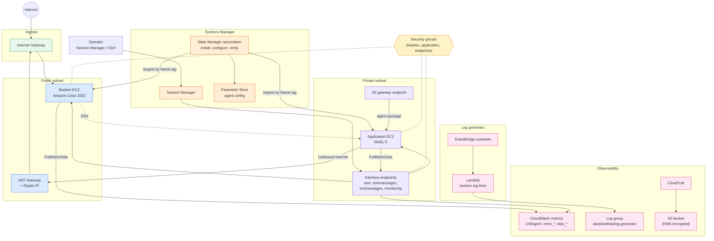
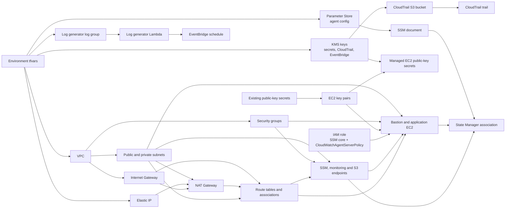

# EC2 + Systems Manager + CloudWatch Agent + CloudTrail

This implementation builds a VPC with a public and a private subnet, a bastion
EC2 instance and an application EC2 instance, both managed through AWS Systems
Manager. The CloudWatch agent is installed and configured on both instances
through State Manager to publish memory and disk metrics. A CloudTrail trail
writes to a KMS-encrypted S3 bucket, and a scheduled Lambda writes random
INFO, WARNING and ERROR log lines to CloudWatch Logs for testing.

## Runtime traffic flow



The bastion has a public IP and an inbound SSH rule, while the application
instance has no public IP and accepts SSH only from the bastion security group.
The private route table sends `0.0.0.0/0` to the NAT gateway in the public
subnet, so the application instance has outbound internet access. AWS service
traffic for Systems Manager, CloudWatch and S3 still uses the VPC endpoints.

## CloudWatch agent rollout

A single custom SSM document runs three ordered steps on each instance, so a
successful run means the agent is installed, configured and running.

1. `aws:configurePackage` installs `AmazonCloudWatchAgent`.
2. `aws:runDocument` runs `AmazonCloudWatch-ManageAgent` to apply the config
   stored in Parameter Store and restart the agent.
3. `aws:runShellScript` checks the agent status and fails unless it is `running`.

The association targets instances by `tag:Name` and re-runs every 30 minutes, so
it applies as soon as an instance registers with SSM and heals after a failed run.

| Metrics | Names (namespace `CWAgent`, dimension `InstanceId`) |
| --- | --- |
| Memory | `mem_used`, `mem_available`, `mem_total` |
| Root filesystem | `disk_used`, `disk_free`, `disk_total` |

## Terraform dependency flow



Terraform uses the base modules under `modules/base/` for each component,
including `ssm-document`, `ssm-association` and `eventbridge-rule`. The CloudTrail
ARN is built from the trail name so that the bucket and KMS policies do not
depend on the trail resource.

## Usage

```bash
terraform init
terraform apply -var-file=environments/dev.tfvars
aws ssm start-session --target <bastion_mon_ec2_instance_id>   # also printed as output ssm_start_session
```

Requires the AWS CLI Session Manager plugin on your machine. The instances
register with SSM a few minutes after launch.

## Verification

```bash
# Agent status on an instance
sudo /opt/aws/amazon-cloudwatch-agent/bin/amazon-cloudwatch-agent-ctl -m ec2 -a status

# Association result (from your own credentials, not the instance role)
aws ssm list-associations --association-filter-list key=AssociationName,value=<name>-cw-agent-setup
aws ssm start-associations-once --association-ids <association-id>   # re-run immediately
```

Metrics appear under CloudWatch → Metrics → `CWAgent`, and generated logs under
`/aws/lambda/<log_generator_name>`.

## Notes

- `monitoring = true` enables detailed (one-minute) EC2 metrics on both
  instances, which is billed per instance.
- Changing the RHEL `user_data` forces instance replacement; the agent rollout
  deliberately avoids `user_data` for that reason.
- The `eventbridge_kms` key is created for event-bus encryption; no event bus
  uses it yet.
- The NAT gateway is a single gateway in one public subnet, so it is not
  highly available and is billed hourly plus per GB processed. Set
  `nat_gateways = []` and `nat_gw_name = null` on the private route table to
  keep the private subnet fully private.
- To put endpoints in more AZs, add subnets and list them in
  `endpoint_extra_subnet_names`.
