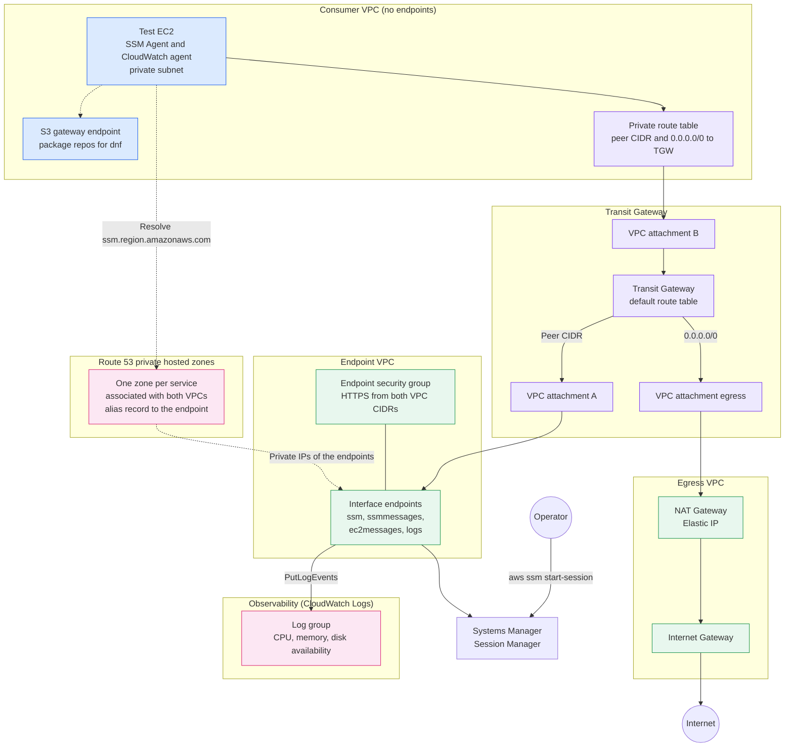
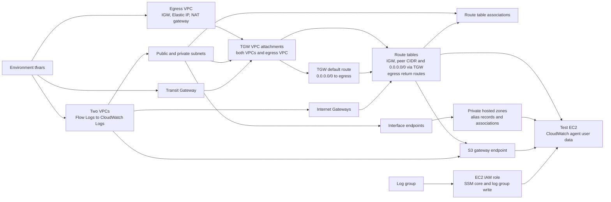

# Shared Resource Setup Architecture

This implementation builds two VPCs, each with public and private subnets, plus a
centralized egress VPC, and connects all three through a Transit Gateway. The
egress VPC holds the only NAT gateway, so the private subnets of the two VPCs
reach the internet through it and every outbound connection leaves from one
public IP.

One of the two VPCs hosts the SSM, SSM messages, EC2 messages, and CloudWatch
Logs interface endpoints. The other VPC reuses those endpoints through private
hosted zones instead of creating its own. A test EC2 instance in the second VPC
has no public IP and no inbound rules, and you reach it with Session Manager. The
CloudWatch agent on that instance ships CPU, memory, and disk availability to a
CloudWatch log group through the shared Logs endpoint, which tests that the
endpoint works from a VPC that has none of its own.

## Runtime traffic flow

### Internet access through the egress VPC

The private route tables of each VPC send the other VPC's CIDR and `0.0.0.0/0` to
the Transit Gateway. The Transit Gateway default route table sends `0.0.0.0/0` to
the egress VPC attachment, and the other VPCs' CIDRs reach their own attachments
by route propagation. The private subnets of the egress VPC (the attachment
subnets) route `0.0.0.0/0` to the NAT gateway, which sits in the first public
subnet of `egress_vpc` and goes out through the Internet Gateway. The egress public
route table sends each VPC's CIDR back to the Transit Gateway for the return
traffic.

- There is one NAT gateway in one availability zone, so an outage of that zone cuts
  internet access for all VPCs. Add a NAT gateway and a private route table per
  zone if you need higher availability.
- Public subnets in the two VPCs keep their own Internet Gateway route.
- The default Transit Gateway route table lets all three VPCs reach each other. Use
  separate Transit Gateway route tables if the two VPCs must be isolated.
- To test, open a session on the EC2 and run `curl -s https://checkip.amazonaws.com`.
  The result should match the `egress_nat_public_ip` output.

### Egress route rules

| Route table | Destination | Target | Purpose |
| --- | --- | --- | --- |
| Egress public (NAT gateway subnet) | `0.0.0.0/0` | Internet Gateway | NAT output to the internet. |
| Egress public (NAT gateway subnet) | each VPC CIDR | Transit Gateway | Return traffic. Without it, replies are dropped and connections hang. |
| Egress private (attachment subnets) | `0.0.0.0/0` | NAT Gateway | Traffic arriving from the Transit Gateway. |
| Transit Gateway default | `0.0.0.0/0` | Egress attachment | Static route, created by `tgw_internet_route`. |
| Transit Gateway default | each VPC CIDR | Its own attachment | Propagated. |
| Each VPC private | `0.0.0.0/0` | Transit Gateway | Created by `spoke_internet_route`. |
| Each VPC private and public | the other VPC CIDR | Transit Gateway | Created by `local_peer_route`. |

The egress public route table is the one most often missed: the NAT gateway
translates the reply and then looks up the private address of the VPC in that
table. The egress private route table needs no VPC CIDR routes, because replies
leave from the public subnet. Other points to check:

- The CIDRs of all three VPCs must be unique, because the Transit Gateway routes
  by CIDR.
- With one shared Transit Gateway route table the two VPCs can also reach each
  other. For internet-only egress, use one Transit Gateway route table for the
  VPCs with only `0.0.0.0/0`, and one for the egress attachment with the VPC
  CIDRs, or add blackhole routes.
- With one NAT gateway per zone, add a private route table per zone and enable
  appliance mode on the egress attachment so traffic stays in the same zone in
  both directions.
- The default network ACL allows everything. If you restrict the egress public
  subnet, allow ephemeral ports (1024-65535) inbound for the replies.
- The security groups that matter are on the instances in the VPCs, which need
  outbound `0.0.0.0/0`. The egress VPC itself holds no instances.

### Shared interface endpoints

Private DNS is turned off on the endpoints. The hosted zones are the only thing
that maps each service name to its endpoint, and each zone is associated with
both VPCs, so the endpoint VPC needs the association as much as the consumer VPC
does. A VPC without the association resolves the service names to the public AWS
addresses, which fail in subnets with no internet route. Each zone name is built
from the `endpoint_services` suffix and the provider region, for example
`ssmmessages.us-east-1.amazonaws.com`.

`endpoint_vpc_name` picks the VPC that hosts the endpoints, and the test EC2 goes
in the first private subnet of the other VPC. The `vpcs` map takes exactly two
entries, each with at least two subnets. The CIDR blocks of both VPCs and
`egress_vpc` must not overlap, because the Transit Gateway routes by CIDR.

### Metrics to CloudWatch Logs

The instance installs the CloudWatch agent with `dnf` at first boot. The Amazon
Linux 2023 repos live in S3, so an S3 gateway endpoint in the consumer VPC's
private route table lets the install work without relying on the NAT path. A
small systemd service appends one JSON line a minute to
`/var/log/resource-metrics.log` with `cpu_available_pct`, `memory_available_mb`,
`memory_available_pct`, `disk_available_gb`, and `disk_available_pct`. The agent
tails that file into the log group, one stream per instance ID. Metrics go through
a log file because the agent's built-in metrics collection would use the
CloudWatch Metrics API, which has no endpoint here. The role can write only to
that log group. Changing the user data replaces the instance.

To test the Logs endpoint, open a session with `ssm_start_session_command`, run
`nslookup logs.us-east-1.amazonaws.com` to check for private IPs, then run
`verify_log_command` from a workstation. Lines arriving in the log group mean the
shared endpoint works. Removing `logs` from `endpoint_services` should stop new
lines, but the egress path then lets the agent reach the public Logs API through
the NAT gateway, so also remove the `0.0.0.0/0` route or the egress VPC to prove
the private path.

## Terraform dependency flow

Terraform uses only base modules under `modules/base/` for every component: the
VPCs, subnets, internet gateways, Elastic IP, NAT gateway, route tables and
associations, Transit Gateway, attachments, VPC routes (`route`), Transit Gateway
routes (`tgw-route`), interface and S3 endpoints (`vpc-endpoint`), private hosted
zones with alias records and VPC associations (`route53-alias-zone`), log group,
security groups, IAM role, and EC2 instance. The `main.tf` of this implementation
declares no resources of its own, and the AMI and region lookups are in
`data.tf`. The EC2 instance depends on the endpoints, zone associations, and
Transit Gateway routes, so the SSM Agent can register on first boot.

The module exposes `vpc_ids`, `vpc_cidr_blocks`, `public_subnets`,
`private_subnets`, `internet_gateway_ids`, `transit_gateway_id`,
`tgw_attachment_ids`, `egress_vpc_id`, `egress_nat_public_ip`,
`egress_tgw_attachment_id`, `vpc_endpoint_ids`, `ec2_instance_id`,
`ssm_start_session_command`, `ec2_log_group_name`, and `verify_log_command` as
outputs.
